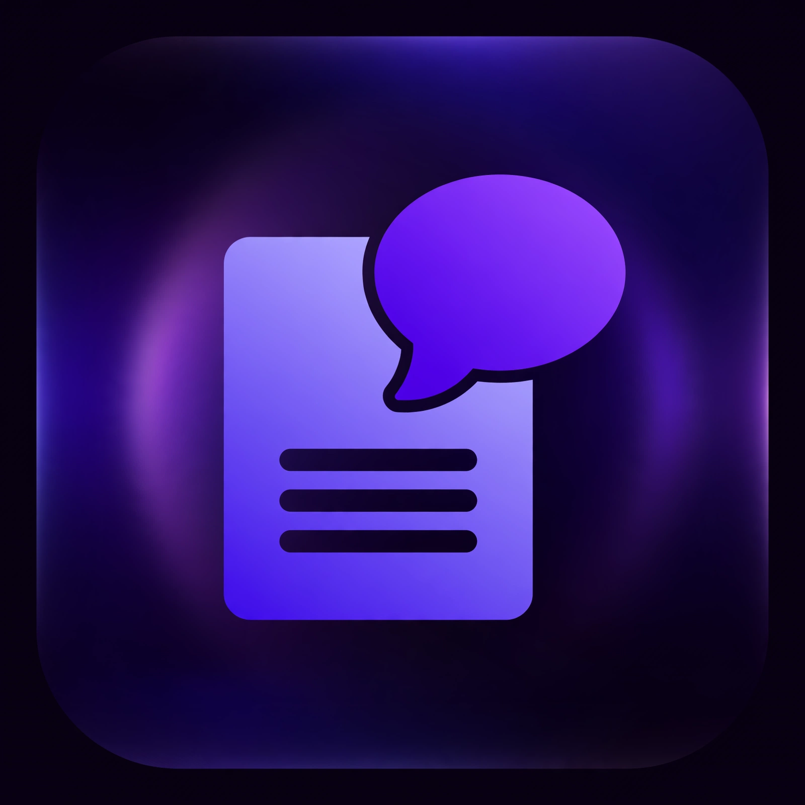
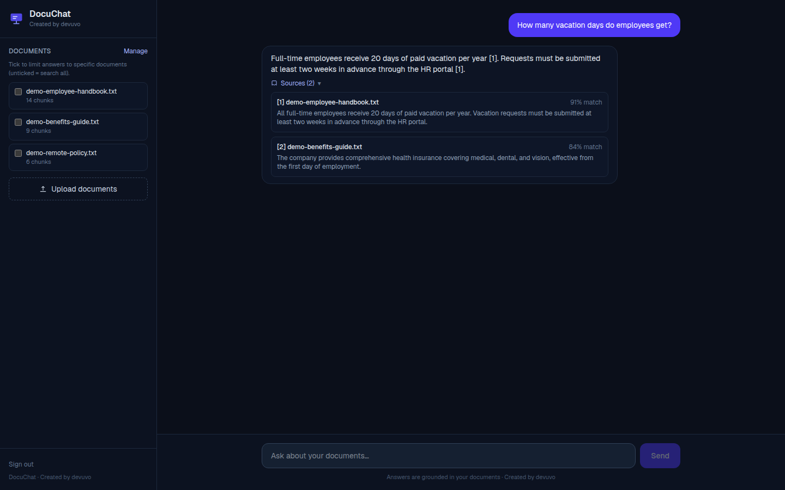
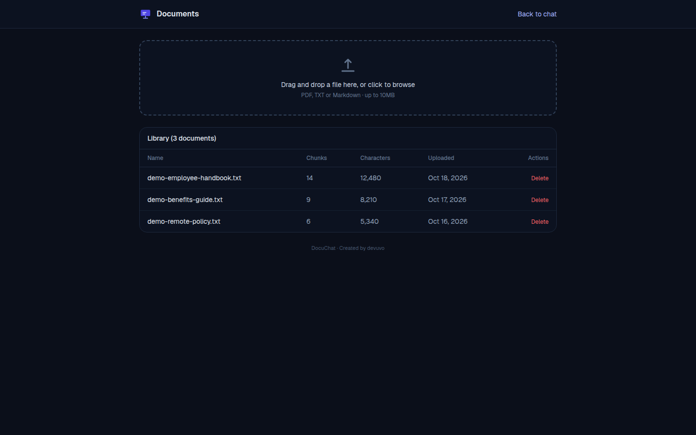

# DocuChat

[](LICENSE)
[](https://nextjs.org/)
[](supabase/migrations/001_init.sql)



*Created by devuvo*

A **RAG (retrieval-augmented generation) chatbot**: upload PDFs, text, or Markdown files, ask questions in plain language, and get streaming answers **grounded in your documents** — with cited sources. If the answer isn't in your documents, DocuChat says so instead of guessing.

Built with **Next.js 16 + TypeScript**, the **Vercel AI SDK** (streaming chat), **OpenAI** (`text-embedding-3-small` embeddings + `gpt-4o-mini`), and **Supabase pgvector** for semantic search. Bring your own credentials — nothing is hardcoded.




## Architecture

```
  ┌────────────┐   upload .pdf/.txt/.md   ┌─────────────────┐
  │  Next.js   │ ─────────────────────────▶ │ /api/documents  │
  │  UI        │                            │ 1. extract text │
  │  (chat +   │                            │ 2. chunk (~1000 │
  │  library)  │                            │    chars, 200   │
  └─────┬──────┘                            │    overlap)     │
        │ ask a question                    │ 3. embed batches│
        ▼                                   │ 4. store chunks │
  ┌─────────────┐                           │    + vectors    │
  │ /api/chat   │                           └────────┬────────┘
  │ 1. embed    │                                    │ pgvector
  │    query    │                                    ▼
  │ 2. match_   │                           ┌─────────────────┐
  │    documents│◀── top-6 chunks ──────────│   Supabase      │
  │    (pgvector│    cosine similarity      │   documents +   │
  │    HNSW)    │                           │   document_     │
  │ 3. grounded │                           │   chunks        │
  │    prompt + │                           └─────────────────┘
  │    stream   │
  │    answer   │
  │    + sources│
  └─────────────┘
```

## How RAG works here

1. **Chunk** — uploaded files are split into ~1000-character paragraph-aware chunks with 200-character overlap, so context survives chunk boundaries (`lib/chunk.ts`).
2. **Embed** — each chunk is embedded with `text-embedding-3-small` (1536 dimensions) in batches of 100 with retry on rate limits (`lib/embeddings.ts`).
3. **Retrieve** — when you ask a question, the query is embedded the same way and `match_documents()` finds the top-6 chunks by cosine similarity (HNSW index) above a 0.3 threshold, scoped to your user id (`lib/rag.ts`).
4. **Generate** — the chunks become a grounded system prompt ("answer ONLY from the provided context; cite sources like [1]; if the answer isn't in the context, say so"). The answer streams via the Vercel AI SDK, and sources travel as a `data-sources` stream part so the UI renders citations as the answer arrives.

## Setup (no coding required)

1. **Supabase project** — create a free one at supabase.com. In the SQL editor, run `supabase/migrations/001_init.sql` (enables pgvector, creates `documents` + `document_chunks`, the `match_documents` function, and RLS). Enable **Email** auth provider (Authentication > Providers).
2. **OpenAI API key** — create one at platform.openai.com/api-keys.
3. **Environment** — copy `.env.example` to `.env.local` and fill in:
   - `OPENAI_API_KEY`
   - `NEXT_PUBLIC_SUPABASE_URL`, `NEXT_PUBLIC_SUPABASE_ANON_KEY`
   - `SUPABASE_SERVICE_ROLE_KEY` (server only — never expose to the browser)
4. **Run** — `npm install` → `npm run dev` → open http://localhost:3000 → sign up → upload documents → ask questions.
5. **Deploy** — push to GitHub and import in Vercel; add the same four env vars in the Vercel dashboard.

## Cost notes

Embeddings (`text-embedding-3-small`) and chat (`gpt-4o-mini`) bill to **your own** OpenAI key. Typical cost: a few cents per hundred documents ingested; chat is a fraction of a cent per question. Supabase free tier covers the database.

## Files

- `app/page.tsx` — chat UI (sidebar with retrieval scope, streaming thread, sources panel)
- `app/documents/page.tsx` — document library with drag-and-drop upload
- `app/api/chat/route.ts` — RAG pipeline + streaming
- `app/api/documents/route.ts` — upload/ingest/list/delete
- `lib/` — chunking, embeddings, Supabase clients, retrieval
- `supabase/migrations/001_init.sql` — schema + `match_documents()`

## Limitations

- 10MB max per file; chunking is optimized for English prose.
- Answers are only as good as the uploaded documents — no outside knowledge.
- No live end-to-end test was possible in the build sandbox (no real Supabase project or OpenAI key there); the SQL was manually reviewed twice and the UI boot-tested headless.

## License

DocuChat is released under the **devuvo Community License v1.0** — free to use, copy, modify, and share for personal, educational, and non-commercial purposes with visible credit ("Created by devuvo" + link to https://www.devuvo.com). Commercial use requires prior written approval from devuvo (admin@devuvo.com); devuvo may grant approval with or without a license fee at its sole discretion. Fair use — screenshots, excerpts, and demos for review, teaching, or commentary — is always allowed with credit. Provided as-is, no warranty. See [LICENSE](LICENSE).

*Created by devuvo · https://www.devuvo.com*
